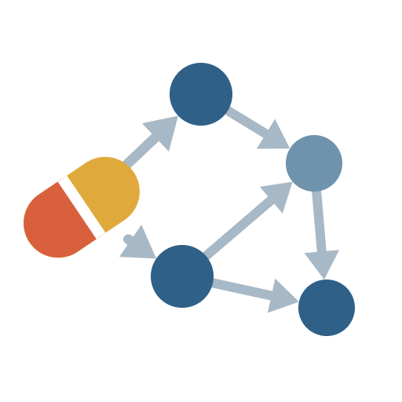
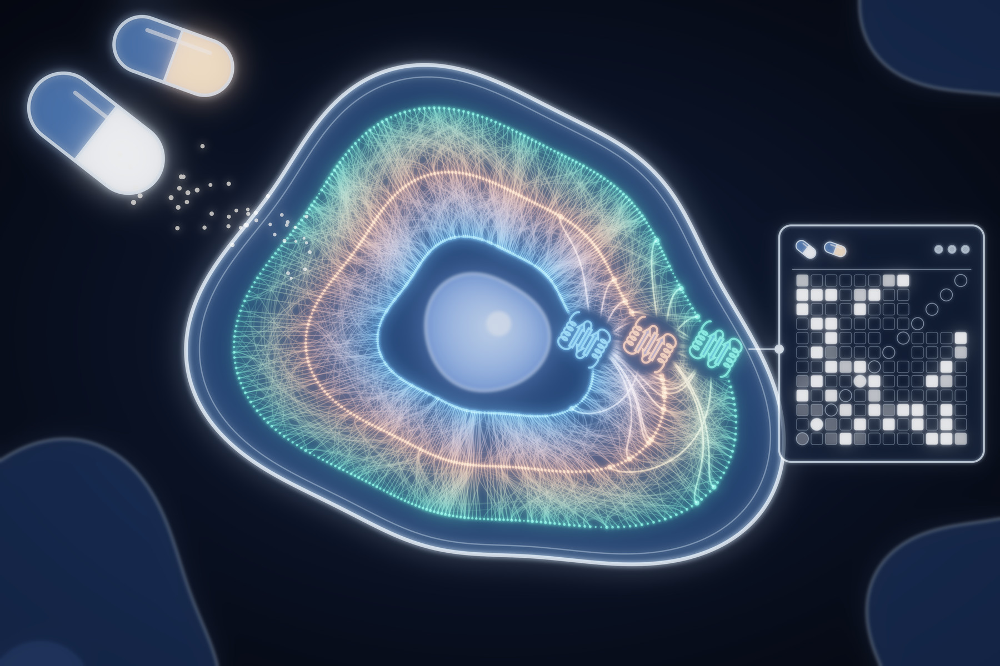

# Drug-Prot 

[Drug-Prot](https://markus-ulmer.ch/DrugProt/) is a web application for exploring a large perturbation proteomics experiment in breast cancer.
In perturbation proteomics, cells are treated with drugs, and the abundance of thousands of proteins is measured afterwards.
The experiment behind Drug-Prot covers 18 breast cancer cell lines, 63 single drugs, and 59 drug pairs, with 5,078 proteins measured 6, 24, and 48 hours after treatment.

You enter the proteins you care about, and Drug-Prot answers three questions.

- Which drugs change the abundance of these proteins, and at which time point?
- For which drug pairs does the combined effect differ from the sum of the two single-drug effects?
- Which other proteins change before or after yours?

Every answer comes with a p-value that is corrected only for the proteins you asked about.
A focused question therefore has more power than a search across all 5,078 proteins.
The drug effects have a causal interpretation, because the experimenter assigned the treatments.
The dependencies between proteins are associations ordered in time, and they serve to generate hypotheses.

Drug-Prot runs in the browser and needs no installation or access to the raw data.
Two built-in examples show what a query looks like, and the [preprint](https://doi.org/10.64898/2026.06.17.732914) describes the methods.

# SDModels 

[SDModels](https://markusul.github.io/SDModels/) is an R package for estimating sparse nonlinear direct effects when unobserved confounders are present.
It builds on spectral deconfounding (Ćevid, Bühlmann, and Meinshausen (2020), Guo, Ćevid, and Bühlmann (2022)), a transformation of the data that reduces the bias from confounders affecting many covariates.
The estimates are reliable when the data has many covariates and the confounding is dense.
The package implements Spectrally Deconfounded Additive Models (SDAMs) (Scheidegger, Guo, and Bühlmann (2025)) and Spectrally Deconfounded Random Forests (SDForest) (Ulmer, Scheidegger, and Bühlmann (2026)).

# Ancestor Regression 

[AncReg](https://markusul.github.io/AncReg/) is an R package that tests for ancestral connections between variables, that is, whether one variable is a direct or indirect cause of another.
It covers linear structural equation models (Schultheiss and Bühlmann (2023)) and structural vector autoregressive models for time series (Schultheiss, Ulmer, and Bühlmann (2025)).
The tests control the rate of false causal discoveries asymptotically.
They draw their power from non-Gaussian distributions in the data.