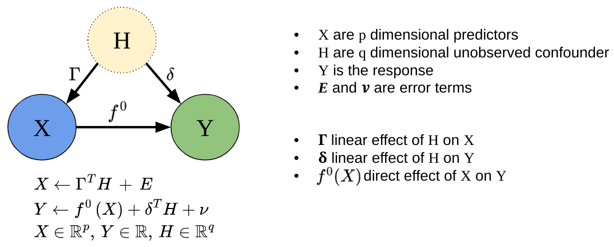
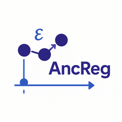

# Drug-Prot 

[Drug-Prot](https://markus-ulmer.ch/DrugProt/) is an interactive R Shiny application for querying statistical evidence of drug effects, drug–drug interactions, and directed temporal protein dependencies in a large-scale perturbation proteomics dataset.

You specify a set of proteins of interest, and Drug-Prot returns two results for that set.
The first is a corrected p-value for the effect of each of 63 single drugs and 59 drug combinations on protein expression at 6, 24, and 48 hours after treatment.
The second is a directed temporal dependency network that links the queried proteins to any other protein in the dataset.
Multiple-testing correction is applied only over the queried set, so focused analyses have more power than proteome-wide searches.

All statistical evidence (approximately 55 million p-values across 5,078 proteins, 122 treatments, and three time points) is precomputed, so queries return almost instantly and the underlying proteomic dataset is never needed at query time.

# SDModels 

[SDModels](https://markusul.github.io/SDModels/) is an R package for estimating sparse nonlinear direct effects when unobserved confounders are present.
It builds on spectral deconfounding (Ćevid, Bühlmann, and Meinshausen (2020), Guo, Ćevid, and Bühlmann (2022)), a transformation of the data that reduces the bias from confounders affecting many covariates.
The estimates are reliable when the data has many covariates and the confounding is dense.
The package implements Spectrally Deconfounded Additive Models (SDAMs) (Scheidegger, Guo, and Bühlmann (2025)) and Spectrally Deconfounded Random Forests (SDForest) (Ulmer, Scheidegger, and Bühlmann (2026)).

# Ancestor Regression 

[Ancestor Regression (AncReg)](https://markusul.github.io/AncReg/) is a package with methods to test for
ancestral connections in linear structural equation models (C.
Schultheiss and Bühlmann (2023)) and structural vector autoregressive
models (Christoph Schultheiss, Ulmer, and Bühlmann (2025)). Ancestor
Regression provides explicit error control for false causal discovery,
at least asymptotically. To have power, however, it relies on
non-Gaussian distributions.